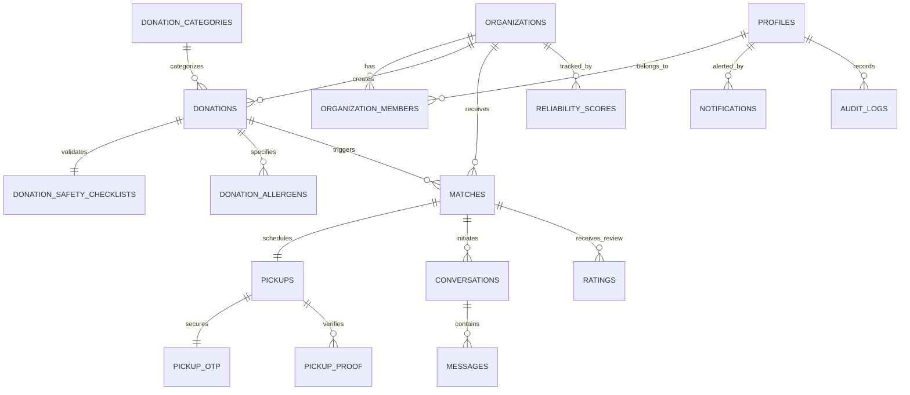

# FoodBridge — Data Model & Schema Architecture

**Document Version:** 2.0  
**Database:** PostgreSQL 15+ on Supabase with PostGIS extensions  
**Status:** Synchronized with active database schema

---

## 1. Entity-Relationship Overview



---

## 2. Table Specifications

### 2.1 Identity & Access (`profiles`, `organizations`, `organization_members`)

- **`profiles`**
  - `id`: `uuid` (references `auth.users.id` on delete cascade, Primary Key)
  - `email`: `text` (unique, not null)
  - `full_name`: `text` (nullable)
  - `role`: `text` (check `role in ('PROVIDER', 'NGO', 'ADMIN', 'CSR')`, default `'PROVIDER'`)
  - `phone`: `text` (nullable)
  - `created_at`: `timestamptz` (default `now()`)

- **`organizations`**
  - `id`: `uuid` (Primary Key, default `uuid_generate_v4()`)
  - `public_id`: `text` (unique, formatted as `FB-ORG-XXXXXX`)
  - `name`: `text` (not null)
  - `type`: `text` (check `type in ('RESTAURANT', 'HOTEL', 'SUPERMARKET', 'SHELTER', 'FOOD_BANK', 'COMMUNITY_KITCHEN', 'CORPORATE')`)
  - `email`: `text` (not null)
  - `phone`: `text` (not null)
  - `address`: `text` (not null)
  - `city`: `text` (not null)
  - `state`: `text` (not null)
  - `pincode`: `text` (not null)
  - `coordinates`: `geography(Point, 4326)` (spatial coordinates for proximity calculations)
  - `verification_status`: `text` (check `verification_status in ('PENDING', 'VERIFIED', 'REJECTED', 'SUSPENDED')`, default `'PENDING'`)
  - `operating_radius_km`: `integer` (default 15)
  - `capacity_meals`: `integer` (default 500)
  - `created_at`: `timestamptz` (default `now()`)

- **`organization_members`**
  - `organization_id`: `uuid` (references `organizations(id)` on delete cascade)
  - `user_id`: `uuid` (references `profiles(id)` on delete cascade)
  - `role`: `text` (check `role in ('ADMIN', 'MEMBER')`, default `'MEMBER'`)
  - Primary Key: `(organization_id, user_id)`

---

### 2.2 Surplus Food Donations (`donations`, `donation_categories`, `checklists`, `allergens`)

- **`donation_categories`**
  - `id`: `uuid` (Primary Key)
  - `name`: `text` (unique, e.g., 'Cooked Meals', 'Fresh Produce', 'Packaged Food', 'Dairy & Eggs', 'Bakery')
  - `is_active`: `boolean` (default `true`)

- **`donations`**
  - `id`: `uuid` (Primary Key)
  - `provider_id`: `uuid` (references `organizations(id)` on delete cascade)
  - `category_id`: `uuid` (references `donation_categories(id)`)
  - `food_name`: `text` (not null)
  - `description`: `text` (nullable)
  - `quantity`: `numeric` (not null, check `quantity > 0`)
  - `quantity_unit`: `text` (check `quantity_unit in ('kg', 'portions', 'boxes', 'liters')`)
  - `meals_estimate`: `integer` (not null, calculated as `quantity * conversion_factor`)
  - `food_type`: `text` (check `food_type in ('VEG', 'NON_VEG', 'VEGAN')`)
  - `prepared_at`: `timestamptz` (not null)
  - `consume_before`: `timestamptz` (not null, must be > `prepared_at`)
  - `pickup_address`: `text` (not null)
  - `pickup_location`: `geography(Point, 4326)` (PostGIS spatial coordinates)
  - `status`: `text` (check `status in ('AVAILABLE', 'MATCHED', 'PICKUP_SCHEDULED', 'PICKED_UP', 'DELIVERED', 'DISTRIBUTED', 'EXPIRED', 'CANCELLED')`, default `'AVAILABLE'`)
  - `created_at`: `timestamptz` (default `now()`)

- **`donation_safety_checklists`**
  - `donation_id`: `uuid` (references `donations(id)` on delete cascade, Primary Key)
  - `proper_storage`: `boolean` (not null)
  - `safe_packaging`: `boolean` (not null)
  - `temp_controlled`: `boolean` (not null)
  - `completed_at`: `timestamptz` (default `now()`)

- **`donation_allergens`**
  - `id`: `uuid` (Primary Key)
  - `donation_id`: `uuid` (references `donations(id)` on delete cascade)
  - `allergen`: `text` (e.g., 'Nuts', 'Dairy', 'Gluten', 'Soy', 'Shellfish')

---

### 2.3 Intelligent Matching & Requests (`matches`)

- **`matches`**
  - `id`: `uuid` (Primary Key)
  - `donation_id`: `uuid` (references `donations(id)` on delete cascade)
  - `ngo_id`: `uuid` (references `organizations(id)` on delete cascade)
  - `score`: `numeric` (0 to 100 calculated matching score)
  - `status`: `text` (check `status in ('PENDING', 'ACCEPTED', 'REJECTED', 'CANCELLED', 'EXPIRED')`, default `'PENDING'`)
  - `expires_at`: `timestamptz` (not null)
  - `request_note`: `text` (optional logistics note submitted by NGO)
  - `created_at`: `timestamptz` (default `now()`)

---

### 2.4 Pickup Logistics & OTP Verification (`pickups`, `pickup_otp`, `pickup_proof`)

- **`pickups`**
  - `id`: `uuid` (Primary Key)
  - `match_id`: `uuid` (references `matches(id)` on delete cascade, unique)
  - `scheduled_time`: `timestamptz` (not null)
  - `pickup_person_name`: `text` (not null)
  - `pickup_person_phone`: `text` (not null)
  - `status`: `text` (check `status in ('SCHEDULED', 'IN_TRANSIT', 'COMPLETED', 'FAILED')`, default `'SCHEDULED'`)
  - `failure_reason`: `text` (nullable)
  - `created_at`: `timestamptz` (default `now()`)

- **`pickup_otp`**
  - `pickup_id`: `uuid` (references `pickups(id)` on delete cascade, Primary Key)
  - `otp_hash`: `text` (not null)
  - `expires_at`: `timestamptz` (not null)
  - `is_used`: `boolean` (default `false`)
  - `attempts`: `integer` (default 0, rate-limited to max 5)
  - `created_at`: `timestamptz` (default `now()`)

- **`pickup_proof`**
  - `id`: `uuid` (Primary Key)
  - `pickup_id`: `uuid` (references `pickups(id)` on delete cascade)
  - `proof_url`: `text` (nullable)
  - `notes`: `text` (condition and temperature verification notes)
  - `created_at`: `timestamptz` (default `now()`)

---

### 2.5 Realtime Communication & Reputation (`conversations`, `messages`, `ratings`, `reliability_scores`)

- **`conversations`**
  - `id`: `uuid` (Primary Key)
  - `match_id`: `uuid` (references `matches(id)` on delete cascade, unique)
  - `provider_org_id`: `uuid` (references `organizations(id)`)
  - `ngo_org_id`: `uuid` (references `organizations(id)`)
  - `created_at`: `timestamptz` (default `now()`)

- **`messages`**
  - `id`: `uuid` (Primary Key)
  - `conversation_id`: `uuid` (references `conversations(id)` on delete cascade)
  - `sender_org_id`: `uuid` (references `organizations(id)`)
  - `content`: `text` (not null)
  - `created_at`: `timestamptz` (default `now()`)

- **`ratings`**
  - `id`: `uuid` (Primary Key)
  - `match_id`: `uuid` (references `matches(id)` on delete set null)
  - `reviewer_org_id`: `uuid` (references `organizations(id)` on delete cascade)
  - `target_org_id`: `uuid` (references `organizations(id)` on delete cascade)
  - `score`: `integer` (check `score between 1 and 5`)
  - `review`: `text` (optional)
  - `created_at`: `timestamptz` (default `now()`)
  - Constraint: `unique(match_id, reviewer_org_id)` (prevents duplicate ratings)

- **`reliability_scores`**
  - `organization_id`: `uuid` (references `organizations(id)` on delete cascade, Primary Key)
  - `score`: `numeric` (check `score between 0 and 100`, default 100)
  - `total_completed`: `integer` (default 0)
  - `total_failed`: `integer` (default 0)
  - `last_calculated_at`: `timestamptz` (default `now()`)

---

### 2.6 Auditability & Notifications (`audit_logs`, `notifications`)

- **`audit_logs`**
  - `id`: `uuid` (Primary Key)
  - `actor_id`: `uuid` (references `profiles(id)` on delete set null)
  - `action`: `text` (not null)
  - `entity_type`: `text` (not null)
  - `entity_id`: `uuid` (nullable)
  - `metadata`: `jsonb` (contextual data, IP, status before/after)
  - `created_at`: `timestamptz` (default `now()`)

- **`notifications`**
  - `id`: `uuid` (Primary Key)
  - `user_id`: `uuid` (references `profiles(id)` on delete cascade)
  - `type`: `text` (not null)
  - `title`: `text` (not null)
  - `message`: `text` (not null)
  - `is_read`: `boolean` (default `false`)
  - `action_url`: `text` (link to relevant donation or match)
  - `created_at`: `timestamptz` (default `now()`)

---

## 3. Lifecycle State Machine

```
[AVAILABLE]  ──(Candidate Match Found)──>  [MATCHED]
      │                                       │
      │ (Expiry Cron)                         │ (Provider Accepts Request)
      ▼                                       ▼
  [EXPIRED]                             [PICKUP_SCHEDULED]
                                              │
                                              │ (OTP Verified by Provider)
                                              ▼
                                         [PICKED_UP]
                                              │
                                              │ (Transport Complete)
                                              ▼
                                         [DELIVERED]
                                              │
                                              │ (Grassroots Distribution Complete)
                                              ▼
                                        [DISTRIBUTED]
```
